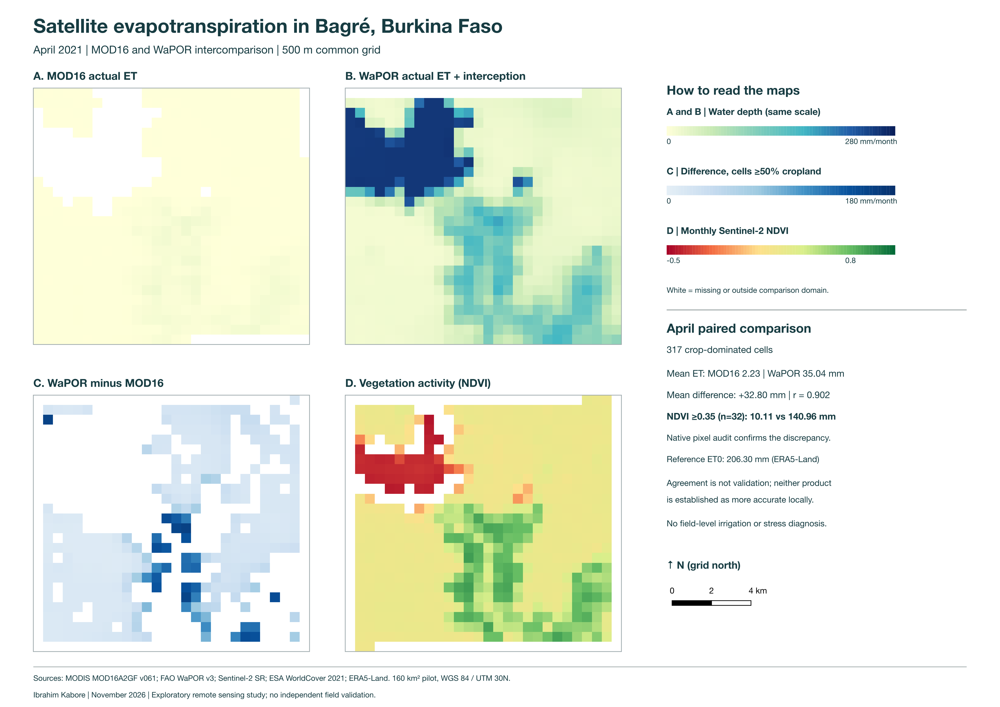

# Satellite evapotranspiration product intercomparison in Bagré, Burkina Faso

Independent remote sensing research demonstration by Ibrahim Kabore, November 2026.

[Printable QGIS map (PDF)](qgis/Bagre_ET_April_2021.pdf)

## Research question

Do MODIS MOD16 and FAO WaPOR capture similar patterns and magnitudes of evapotranspiration in a semi-arid agricultural landscape?

The study covers a 159.95 km² pilot rectangle around Bagré, Burkina Faso (11.41–11.52° N, 0.59–0.47° W), January through April 2021. It is not an official irrigation scheme boundary. WorldCover 2021 identifies approximately 48.36% of available 10 m pixels as cropland; cropland is not equivalent to irrigation or active dry-season cultivation.

## Method

- Earth Engine data acquisition: Sentinel-2 SR Harmonized (NDVI/NDMI), Landsat 8 L2SP (LST), MOD16A2GF v061, FAO WaPOR v3 AETI, ERA5-Land daily and ESA WorldCover 2021.
- Conservative cloud and saturation masks; Landsat uncertainty sensitivity (2, 3, 5, 10 K and no ST_QA filter). A 3 K threshold was selected after 2 K eliminated February and March. Final LST raster valid coverage: 98.87%, 58.51%, 98.68%, 98.87%. February remains incomplete.
- MOD16 accumulated eight-day ET depths (scale 0.1) and WaPOR mean daily dekadal AETI rates (scale 0.1) integrated by actual overlapping calendar days. MOD16 within-composite daily flux assumed constant; WaPOR includes intercepted rainfall evaporation.
- Reference ET0 from approximate FAO-56 Penman–Monteith using daily ERA5-Land center-cell meteorology and SRTM elevation. Daily mean wind-vector magnitude is an approximation.
- Common 500 m UTM 30N grid (26 × 28 cells), area-weighted raster averaging, 80% valid-source coverage filter, paired comparison on 317 cells with ≥50% mapped cropland. Sensitivity to 30% and 70% thresholds. Native projections differ; grid harmonization cannot eliminate representativeness differences.
- Independent native-pixel sample and pandas temporal integration at three contrasting April NDVI locations; no field validation.

## Results

Monthly values in mm; bias and RMSE measure interproduct disagreement, not error against ground truth.

| Month | ET0 | Rainfall | MOD16 mean | WaPOR mean | Bias (WaPOR − MOD16) | RMSE | Pearson r |
|---|---:|---:|---:|---:|---:|---:|---:|
| Jan | 199.18 | 0.02 | 1.89 | 33.90 | 32.01 | 40.49 | 0.652 |
| Feb | 193.91 | 0.03 | 0.66 | 21.12 | 20.46 | 29.85 | 0.309 |
| Mar | 194.16 | 0.40 | 1.01 | 35.47 | 34.46 | 44.13 | 0.646 |
| Apr | 206.30 | 3.70 | 2.23 | 35.04 | 32.80 | 49.18 | 0.902 |

Across April's actively vegetated crop-dominated cells (NDVI ≥0.35, n=32), MOD16 estimates 10.11 mm and WaPOR 140.96 mm (about 14×). At the highest-NDVI diagnostic point (NDVI 0.639), independent native sampling produced MOD16 ET 11.30 mm, MOD16 PET 243.10 mm and WaPOR AETI 173.00 mm. The corresponding gridded MOD16 and WaPOR values were 11.30 and 154.25 mm. The discrepancy is not simply an artifact of the monthly aggregation at the sampled points.

In April, ET correlated positively with NDVI (MOD16 0.946, WaPOR 0.931) and NDMI (0.908, 0.935), and negatively with LST (−0.752, −0.795). Correlations are descriptive; spatial dependence, shared model inputs and mixed pixels preclude independent accuracy or causal inference.

The optional relative screening rule (joint low ET/ET0, high temperature, green cropland) flagged 4 of 32 eligible April cells. Other months had fewer than 10 eligible cells under the primary NDVI threshold, so screening was not performed. This is not a validated crop water stress index or irrigation recommendation.

## Reproduce

Use Google Colab CPU and a registered Earth Engine Cloud project. Create `Bagre_ET_Water_Stress` in My Drive, set the project ID in notebooks 01–04 and 06, then execute in order. The notebooks create the data, outputs, figures and qgis folders. No GPU or trained deep learning model is required.

1. [Study area and data audit](notebooks/01_Study_Area_Data_Audit.ipynb)
2. [Surface temperature and vegetation](notebooks/02_Surface_Temperature_Vegetation.ipynb)
3. [Actual ET products](notebooks/03_Actual_Evapotranspiration.ipynb)
4. [Reference ET and weather](notebooks/04_Reference_ET_Weather.ipynb)
5. [Evaluation and screening](notebooks/05_Evaluation_Stress_QGIS.ipynb)
6. [Native-pixel and product diagnostics](notebooks/06_ET_Product_Diagnostics.ipynb)

The [results folder](results/) contains derived CSVs. The [QGIS folder](qgis/) contains an editable project, its four input rasters and the final April map. To regenerate the layout with a QGIS Python interpreter, run `python build_bagre_layout.py /path/to/common_grid_rasters /path/to/layout_output` with the four required GeoTIFFs in the input directory (see script). Raw Earth observation imagery and reanalysis are not redistributed; the notebooks reproduce the extraction.

## Limitations

No independent flux-tower, field moisture, irrigation or crop-type measurements. The intercomparison does not establish a more accurate product or the cause of disagreement. Four months from one year are insufficient for trend analysis. The reference ET0 is atmospheric demand for a hypothetical reference crop, not crop water requirement. The screening thresholds are exploratory and relative; no physiological or operational claim is made. Some monthly LST composites represent only one valid Landsat acquisition. WaPOR AETI and MOD16 ET are not identical definitions. Model assumptions, inputs and spatial support can all contribute to the differences.

## Sources

- [MOD16A2GF catalog](https://developers.google.com/earth-engine/datasets/catalog/MODIS_061_MOD16A2GF) and [MOD16 user guide](https://lpdaac.usgs.gov/documents/931/MOD16_User_Guide_V61.pdf)
- [FAO WaPOR v3 AETI](https://developers.google.com/earth-engine/datasets/catalog/FAO_WAPOR_3_L1_AETI_D)
- [FAO-56](https://www.fao.org/4/x0490e/x0490e00.htm)
- [ERA5-Land daily](https://developers.google.com/earth-engine/datasets/catalog/ECMWF_ERA5_LAND_DAILY_AGGR)
- [Landsat 8](https://developers.google.com/earth-engine/datasets/catalog/LANDSAT_LC08_C02_T1_L2), [Sentinel-2](https://developers.google.com/earth-engine/datasets/catalog/COPERNICUS_S2_SR_HARMONIZED), [WorldCover](https://developers.google.com/earth-engine/datasets/catalog/ESA_WorldCover_v200)

AI-assisted implementation and QGIS layout; notebook execution, diagnostics and result interpretation by Ibrahim Kabore. This project is an independent educational case study, not an official ESA, FAO or NASA product.
